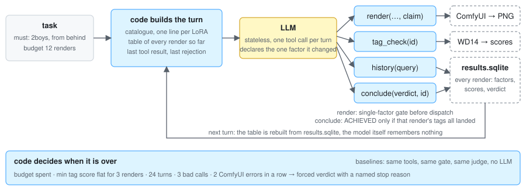
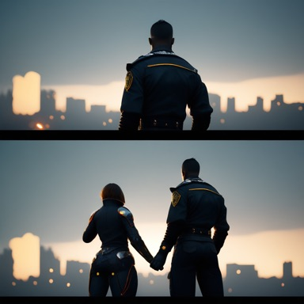
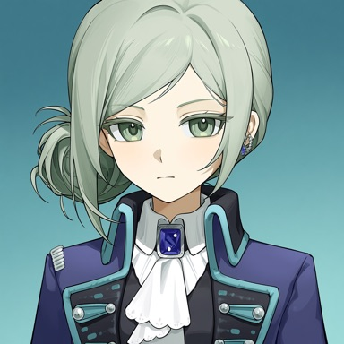

<h1 align="center">comfy-agent</h1>

<p align="center">
  Does an LLM agent earn its keep at the <em>knob</em> tier of ComfyUI image generation?<br/>
  Pick a workflow, a base model and LoRAs from a catalogue, turn one knob at a time, judge with a deterministic tagger, stop when every required tag lands.
</p>

<p align="center">
  
  
  
  
  
</p>

<p align="center">
  
</p>

The model never sees pixels. Every verdict comes from a tagger with a fixed threshold, every render changes exactly one factor, and the code, not the model, decides when a task is over. Two baselines that go through the same tools without a model sit next to the agent in the report, so the question "was the agent worth it" has a number.

> [!NOTE]
> **Measured answer, on this machine and this catalogue: the agent saves renders and judges worse.** On 18 tasks × 3 runs the agent averaged 1.81 renders per task against the hard-coded ladder's 3.98, and was wrong on 8 of 54 runs against the ladder's 4. The one-line conclusion the code writes from the §1 rule is 省渲染，判得不比阶梯准: fewer renders, not more accurate. Where it saves: on tasks the catalogue cannot do, the agent says so after 2–4 renders where both baselines burn the whole budget of 12. Where it loses: the hardest achievable task, and three runs that spent their 24 turns fighting the single-factor gate.

## Results

18 tasks, budget 12 renders each, three runs with seeds 1001/1002/1003 shared across arms. Two workflows, an SDXL/Illustrious graph with two checkpoints and an [Anima](https://huggingface.co/circlestone-labs/Anima) graph with two. 214 LoRAs in the catalogue.

| arm | correct | avg renders | switched workflow / base / LoRA | used history | pass^3 |
|---|:-:|:-:|:-:|:-:|:-:|
| agent (deepseek-chat) | 46/54 | **1.81** | 8/18 | 10/18 | 14/18 |
| hard-coded ladder | 50/54 | 3.98 | 7/18 | 0/18 | 16/18 |
| fixed seed | 51/54 | 3.87 | 0/18 | 0/18 | 17/18 |

522 eval renders plus 888 for the grid, about $2.50 of DeepSeek in total. pass^3 is the τ-bench definition (all three runs correct), not pass@3. n is small; the report is qualitative by design.

**Where the tasks came from.** Ground truth is a grid, not an opinion: before the eval, every task is rendered across base × LoRA × tag weight × six seeds, and a task counts as achievable if any cell lands. The first ten tasks, picked from [RimoChan's per-checkpoint hit rates](https://github.com/RimoChan), all turned out achievable on the first seed, and all three arms solved all of them in one render: no signal. So eight more tasks were chosen by probing 151 tags the catalogue has no LoRA for (the lowest-count characters in the tagger's vocabulary, characters from post-2023 franchises, the rarest general tags) and keeping ones neither base drew. The grid then decided: three are genuine negatives, five are hard positives that land in 1 to 22 of 48 cells.

| task | grid | agent | ladder | fixed seed |
|---|:-:|:-:|:-:|:-:|
| 11 `uzuki sayaka` | 0/48 | **N** 3 · **N** 2 · **N** 2 | N 12 · N 12 · N 12 | N 12 · N 12 · N 12 |
| 12 `valkyrie (fate)` | 1/48 | N 4 · N 2 · N 3 | N 12 · **A** 4 · N 12 | N 12 · N 12 · N 12 |
| 13 `vertin (reverse:1999)` | 0/48 | **N** 4 · **N** 4 · A 3 † | N 12 · N 12 · N 12 | N 12 · N 12 · N 12 |
| 14 `chloe (princess connect!)` | 22/48 | **A** 2 · **A** 2 · **A** 3 | A 7 · A 5 · A 1 | A 3 · A 2 · A 1 |
| 15 `1boy, stark (sousou no frieren)` | 35/48 | A 3 · A 1 · A 3 | A 1 · A 1 · A 1 | A 1 · A 1 · A 1 |
| 16 `1boy, caelus (honkai: star rail)` | 42/48 | A 1 · A 1 · A 1 | A 1 · A 1 · A 1 | A 1 · A 1 · A 1 |
| 17 `streetwear` | 14/48 | **A** 3 · B 4 · **A** 3 | N 12 · A 2 · N 12 | A 8 · A 7 · A 6 |
| 18 `dress shoes` | 0/48 | B 4 · B 5 · B 3 | **N** 12 · **N** 12 · **N** 12 | **N** 12 · **N** 12 · **N** 12 |

A = ACHIEVED, N = NOT_ACHIEVABLE_HERE, B = budget exhausted (24 turns), number = renders. Every task's tags start with `1girl` unless shown. † The agent rendered `vertin, reverse:1999` as two words on the Anima graph and the tagger scored the character 1.00: a prompt the grid never tried, so the grid's "negative" is wrong there and the agent is counted wrong for being right. Grids only know the cells you give them.

## What the judge sees

Four trajectories from the eval, downscaled. Scores are the tagger's probabilities; the threshold is 0.35.

| task | render 1 | render 2 | what happened |
|---|:-:|:-:|---|
| **6** · `2boys, from behind` | <br/>2boys **0.01** · from behind 0.80 | <br/>2boys 0.99 · from behind 0.77 | SDXL drew a man and a woman. The tagger said so. The agent restarted on Anima with `(2boys:1.4)`. Two renders, ACHIEVED. The ladder needed four. |
| **3** · `1girl, grey hair, long hair, purple eyes, white dress, outdoors, smile, looking at viewer` | <br/>grey hair **0.31**, seven others ≥ 0.89 | <br/>grey hair 0.79, seven others ≥ 0.85 | One tag short. The agent claimed `weight:grey hair`, set it to 1.5, nothing else moved. The gate accepted the claim because only that factor changed. |
| **9** · `1girl, 2b (nier:automata)` | <br/>2b (nier:automata) 0.93 | — | The catalogue matched a 2B LoRA through the character tag. The agent opened it at the recommended strength on the first render. |
| **13** · `1girl, vertin (reverse:1999)` | — | <br/>vertin (reverse:1999) **1.00** | Neither base knows the danbooru tag; the grid says impossible. On its third render the agent wrote the name as two words, `vertin, reverse:1999`, and Anima's Qwen text encoder knew the game. The agent found a door the grid did not have. |

Each run leaves a `summary.md` the code writes from the results database:

```
task 6   must: 2boys, from behind   budget 12
model deepseek   tagger wd-eva02-large-tagger-v3 @0.35

#  | claim | factors | scores (! = MISSING) | min
01 | start | workflow:sdxl base:ChenkinNoob-XL-V0.5.safetensors tag:2boys tag:from behind seed:1002 cfg:6.0 steps:30 | 2boys=0.01! from behind=0.80 | min 0.0103
02 | start | workflow:anima base:anima_baseV10.safetensors tag:(2boys:1.4) tag:(from behind:1.0) seed:1002 cfg:5.0 steps:30 | 2boys=0.99 from behind=0.77 | min 0.7713

结论 ACHIEVED @ agent-deepseek-2-6-02（stop_reason model），2 张，model 调用 5 次，109650+681 tokens，24.5 秒
证据（代码回查）：render agent-deepseek-2-6-02: 2boys LANDED 0.99, from behind LANDED 0.77
```

## Why this shape

- **Deterministic judge.** [WD14 eva02](https://huggingface.co/SmilingWolf/wd-eva02-large-tagger-v3) through [tagassert](https://pypi.org/project/tagassert/), threshold 0.35. Same image, same score, every time. With an LLM judge the error rate would be a property of the judge, not of the agent.
- **One factor per render.** The model declares what it changed: `weight:<tag>`, `move:<tag>`, `reword:<old>-><new>`, `lora:<file>`, `knob:<seed|cfg|steps>`, or `start` for a restart on another workflow or base. The code diffs the new render against the previous one ([attribution-gate](https://pypi.org/project/attribution-gate/) for weight changes) and rejects anything that changed two things. The record is a causal chain, not a pile of attempts.
- **The code decides when it is over.** Budget spent, three renders without the minimum tag score rising by 0.02, 24 turns, three bad tool calls, two consecutive ComfyUI errors: each forces a verdict with a named stop reason. The model may conclude `ACHIEVED` only with a render whose tags all landed, and `NOT_ACHIEVABLE_HERE` only with a sentence about what the catalogue lacks. Evidence is regenerated from the database, never taken from the model.
- **Stateless model, stateful code.** Each turn is built from scratch: the catalogue, a table of every render so far with its scores, the last tool result, the last rejection. The model keeps nothing between turns. The first live run showed what happens when the table omits something (see below).
- **Baselines go through the same tools.** A fixed-seed loop and a hard-coded ladder (reorder the lowest tag, weight it, open the matching LoRA, raise cfg, then the next workflow, then seeds) use the same gate, judge and conclude rules with no model. If the agent cannot beat a loop that increments the seed, the agent is the wrong tool for this tier.

## Compared with

- **[GenEval](https://github.com/djghosh13/geneval)** scores text-to-image alignment with an object detector on compositional prompts. Same instinct, a deterministic judge instead of a VLM; different question. GenEval ranks models. This ranks strategies for driving one model.
- **[ComfyBench](https://github.com/xxyQwQ/ComfyBench)** benchmarks agents that build ComfyUI workflows from instructions. This project does not build graphs. The workflows are fixed JSON; the agent chooses between them and turns knobs. Whether graph construction deserves an agent is a later tier.
- **[mini-swe-agent](https://github.com/SWE-agent/mini-swe-agent)** keeps the agent to a hundred lines with bash as the only tool. The loop here is the same size and the same spirit, but the tools are narrow on purpose: no shell, no file access, four calls whose arguments the code can check.

## Quick start

Needs ComfyUI reachable on `127.0.0.1:8188` with the models named in `pipelines/*.json`, the [comfyui-wd14-tagger](https://github.com/pythongosssss/ComfyUI-WD14-Tagger) models directory (the csv and onnx are read from there), and [`tools/wd14_scores`](tools/wd14_scores) copied into `custom_nodes`. `DEEPSEEK_API_KEY` in the environment for the agent arm.

```bash
pip install -e .

# catalogue from LoRA Manager metadata; task files are linted against the tagger vocabulary
python -m comfy_agent --catalog catalog.yaml --out runs catalog build <lora-dir>

# ground truth: base × LoRA × weight × 6 seeds per task, ~45 min for 10 tasks on one GPU
python -m comfy_agent --catalog catalog.yaml --out runs grid --tasks tasks

# one arm, one task, one run — read runs/agent-deepseek/1/007/summary.md afterwards
python -m comfy_agent --catalog catalog.yaml --out runs run --task tasks/007.yaml --arm agent-deepseek --run 1

# the whole thing: three arms, three runs, report.md with the one-line conclusion
python -m comfy_agent --catalog catalog.yaml --out runs eval --tasks tasks \
    --arms agent-deepseek,baseline-seed,baseline-ladder --runs 3
```

`eval` appends one line per finished (arm, run, task) to `runs/rows.jsonl` and resumes from it; a rerun overwrites exactly that scope. Before every task the code asks ComfyUI to free its models and checks that the rest of the GPU is under 10 GB, so the eval refuses to run on top of someone else's training job. Every render's graph is recoverable from the PNG with [`renderdb why`](https://pypi.org/project/renderdb/), and the eval spot-checks that against the database.

```bash
python -m pytest   # 164 tests: scripted provider for the loop, fake ComfyUI for the tools, the real gate library for factors
```

## What went wrong along the way

Five of the eight agent errors above are the model fighting the single-factor gate: a `reword` to a tag the tagger has no word for, a `weight` change bundled with four other edits, a LoRA opened without its triggers. Those are the agent's own. But before the numbers above were real, six live runs each exposed a gap of the same shape: **the model is stateless, so anything the code does not carry did not happen, and anything the gate demands must be visible in the prompt.** Each one became a test.

<details>
<summary>The gaps a live model found</summary>

- **Rendered twelve times, judged none.** The table shown to the model listed only *judged* renders, so every turn looked like turn one. Unjudged renders are now listed with the exact `tag_check` call to make.
- **Asked `history` twenty times for the same empty answer.** The prompt did not say what it had already asked. It now carries `history already asked: …`, and a verbatim repeat of an answered call is refused with "the answer will not change".
- **Concluded with `render_id: null`.** The schema allowed null. It is now a required string, and the rejection names the task's latest render.
- **Wrote a 300-character `missing`.** The limit of 200 was enforced and never stated. It is now stated, and over-long text is truncated instead of refused.
- **Referred to renders by table row, `"03"`.** Reasonable: that is how the table shows them. Row numbers are now accepted as ids.
- **Opened a LoRA at the wrong strength.** The gate required the catalogue strength; the LoRA list the model saw had no strength column. It does now, and the rejection says the number.

</details>

<details>
<summary>Six things that each became a test (before any model ran)</summary>

- **The stock tagger node returns names, not scores.** `WD14Tagger|pysssss` outputs a comma-joined string, so every tag over its own floor scored 1.0 and the whole judging rule was void. [`tools/wd14_scores`](tools/wd14_scores) replicates its preprocessing and returns real probabilities as JSON.
- **Windows hides per-process VRAM.** Under WDDM `nvidia-smi` reports `[N/A]` per process, ComfyUI's `torch_vram_total` reads 0 under `cudaMallocAsync`, and GPU perf counters return nothing from an ssh session. The guard now asks ComfyUI to free its models and reads `vram_total − vram_free` from `/system_stats`.
- **The tagger escapes parentheses.** `2b \(nier:automata\)` never matched the task's tag until the backend unescaped it.
- **`seed_hint` reached the baselines and not the agent**, which picked seed 1 on its own. Now in the prompt.
- **Small ones.** `read_text` without an encoding on a gbk locale; the catalogue took `tags[0]` (a franchise) as a LoRA's kind instead of its `char:` tag; the CLI opened the results database before creating its directory.

</details>

## Layout

```
comfy_agent/
  catalog.py    build catalog.yaml from LoRA metadata; LoRA ↔ task matching
  tasks.py      load + lint tasks against the tagger vocabulary
  graph.py      edit pipeline JSON by node name; build the prompt
  comfy.py      submit, wait, fetch PNG; GPU guard
  factors.py    factor list, claims, single-factor gate
  results.py    results.sqlite
  tools.py      render / tag_check / history / conclude
  loop.py       the loop, stop rules, summary.md
  provider.py   openai client + cassette for replay tests
  baselines.py  fixed seed, hard-coded ladder
  grid.py       ground-truth grid
  eval.py       three runs, report.md, the one-line conclusion
pipelines/      two ComfyUI API graphs
tasks/          ten tasks
tools/wd14_scores/  the score-returning tagger node
assets/    the diagram and gallery above
tests/
```
